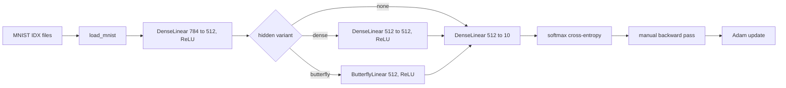

# Implementation Document

This document describes how the experiment in the [specification](specification-doc.md)
is implemented, what complexity was achieved, and what the experiment found.

## 1. Program structure

| File | Responsibility |
|------|----------------|
| `include/vadugrad/tensor.hpp`, `src/tensor.cpp` | Row-major `float` array with bounds-checked indexing, `matmul`, `transpose2d`, `sum` |
| `.../dense_linear.hpp`, `src/dense_linear.cpp` | Dense layer y = xW + b and its gradients |
| `.../butterfly_linear.hpp`, `src/butterfly_linear.cpp` | Butterfly layer: log₂ n stages of 2×2 blocks plus bias, and its gradients |
| `.../nn/activations.hpp`, `.../nn/nn_ops.hpp` | ReLU, stable softmax, cross-entropy and their gradients |
| `.../nn/mlp.hpp`, `src/mlp.cpp` | The experiment's network: chains the layers, runs backpropagation through all of them, initializes weights |
| `.../optim/adam.hpp`, `src/adam.cpp` | Adam optimizer with per-parameter state |
| `.../nn/parameter_init.hpp` | Reproducible normal random numbers (xorshift32 + Box–Muller) |
| `.../data/mnist.hpp`, `src/mnist.cpp` | IDX file reader |
| `apps/train_mnist.cpp` | Command-line program: options, training loop, evaluation, CSV log |
| `scripts/` | MNIST download and the results plot |

Every layer exposes `forward` (which caches what the backward pass needs) and `backward`
(which returns gradients for its input and its parameters). `Mlp::backward` applies the chain
rule by feeding each layer's input gradient to the previous layer.

**Initialization.** Layers followed by a ReLU use He initialization (std = √(2 / fan-in)) and
the output layer uses std = √(1 / fan-in). Each butterfly block has fan-in 2 and uses
std = 1/√2, so every stage preserves the variance of its input. This matters: an earlier
version initialized all weights with std 0.02, which shrinks the signal by roughly 0.03 per
stage. After nine stages nothing reached the output, and the butterfly network stayed at
chance level (loss ln 10 ≈ 2.30, accuracy 10 %).

## 2. Achieved time and space complexity

Let *B* be the batch size, *d* = 784 the input width, *n* = 512 the hidden width, *c* = 10
the number of classes, and *N* = 60,000 the number of training images.

| Part | Time per batch (forward and backward) | Parameters | Cached for backward |
|------|----------------------------------------|------------|---------------------|
| Input layer | Θ(*B d n*) | Θ(*d n*) | Θ(*B d*) |
| Dense hidden layer | Θ(*B n²*) | Θ(*n²*) | Θ(*B n*) |
| Butterfly hidden layer | Θ(*B n* log *n*) | Θ(*n* log *n*) | Θ(*B n* log *n*) |
| Output layer | Θ(*B n c*) | Θ(*n c*) | Θ(*B n*) |

These match the planned complexities. The butterfly forward pass loops over log₂ *n* stages
and, in each stage, over the *n*/2 pairs of every row, doing 4 multiply-adds per pair. The
backward pass visits the same pairs in reverse stage order. One epoch costs
Θ(*N* (*d n* + *h* + *n c*)), where *h* is *n²* for dense, *n* log *n* for butterfly and 0
for none. The input layer (*d n* ≈ 401,000 multiply-adds per image) dominates in every
variant.

### Measured running time

All times are wall-clock seconds for one training epoch in a Release build, averaged over
the 15 epochs (3 seeds × 5 epochs) of each variant, run one at a time. The experiment was run
on two platforms on Apple Silicon hardware: Linux with GCC 15.2 (libstdc++) and macOS 26.4
with Apple Clang 21 (libc++).

| Variant | Hidden multiply-adds per image | Linux / GCC: s per epoch | Extra over `none` | macOS / Clang: s per epoch | Extra over `none` |
|---------|--------------------------------|------|--------|------|--------|
| `none` | 0 | 9.7 | – | 7.5 | – |
| `dense` | 262,144 | 16.0 | +6.3 s | 12.5 | +5.0 s |
| `butterfly` | 9,216 | 11.8 | +2.1 s | 11.9 | +4.3 s |

The butterfly hidden layer does 28× fewer multiply-adds than the dense one, but it is only
about 3× faster with GCC and barely faster (about 1.15×) with Clang. Counting forward and
backward passes (about 3 multiply-adds per weight per image), the dense layer runs at roughly
7.5 billion multiply-adds per second with GCC and 9.5 billion with Clang. The butterfly runs
at roughly 0.8 and 0.4 billion. The dense layer reuses `matmul`, whose inner loop reads
contiguous memory and is vectorized by the compiler. The butterfly loop reads pairs at a
stride that changes every stage, checks bounds on every access, and allocates and copies one
tensor per stage. How much these overheads cost depends heavily on the compiler. The
asymptotic advantage is real, but at *n* = 512 constant factors eat most or all of it.

**Effect of the indexing fix.** The original `Tensor::operator()` built a heap-allocated
`std::vector<int>` for every element access. Replacing it with allocation-free fixed-rank
accessors, and giving `matmul` a cache-friendly loop order, cut the time for one epoch over
2,560 images from 80.9 s to 0.67 s (about 120×), with identical printed loss and accuracy. With the old code
one full epoch would have taken about 32 minutes, which is why training appeared to hang.

## 3. Results

Three seeds per variant, 5 epochs, batch size 64, Adam with learning rate 0.001. Test
accuracy is measured on all 10,000 MNIST test images after the last epoch:

| Variant | Hidden parameters | Linux / GCC: test accuracy (mean ± std, 3 seeds) | macOS / Clang: test accuracy (mean ± std, 3 seeds) |
|---------|-------------------|--------------------|--------------------|
| `none` | 0 | 97.73 % ± 0.40 | 97.99 % ± 0.12 |
| `dense` | 262,656 | 97.82 % ± 0.24 | 97.91 % ± 0.03 |
| `butterfly` | 9,728 | 97.46 % ± 0.38 | 97.74 % ± 0.22 |

The two platforms use the same seeds and the same initial weights (the project's own
xorshift generator), but a different order of training data: the data is shuffled with
`std::shuffle`, whose algorithm differs between libstdc++ and libc++. The second run is
therefore an independent repetition with three more data orders, not a bit-identical copy.

The per-epoch curves are in the [testing document](testing.md#3-empirical-results). The raw
logs are in `results/` (Linux) and `results/macos/` (macOS).

**Interpretation.**

- **The hypothesis holds.** The butterfly variant is 0.36 (Linux) and 0.17 (macOS)
  percentage points behind dense, within the one-point margin, using 27× fewer hidden-layer
  parameters. Butterfly is the least accurate variant in both runs, but only by about the
  size of the seed-to-seed spread.
- **The comparison is weak.** The `none` baseline is as accurate as `dense` in both runs,
  and on macOS it is slightly better. On MNIST, one 512-wide hidden layer is already enough,
  so an extra hidden layer, dense or butterfly, has little to add. The experiment shows that
  a butterfly layer does not *hurt* much. It cannot show whether it *helps* as much as a
  dense layer when extra capacity is actually needed.
- **Overfitting.** By epoch 5 the training loss is about 0.03, ten times lower than any test
  loss. In the Linux runs the test loss of `dense` and `butterfly` rises again after 3–4
  epochs, and in the macOS runs the `dense` test loss fluctuates. Longer training would not
  change the picture without regularization or early stopping.

## 4. Limitations and possible improvements

- **A task where the hidden layer matters.** Using a harder dataset (for example
  Fashion-MNIST, which has the same file format) or a narrower first layer would make the
  dense-versus-butterfly difference measurable. Another option is to pad the input to
  1,024 pixels and use the butterfly as the first layer itself.
- **Statistics.** Three seeds and five epochs are enough to see the order of magnitude, but
  not to separate differences of 0.1–0.4 points. More seeds, a validation split and early
  stopping would make the comparison stronger.
- **Butterfly speed.** Working on raw pointers without bounds checks, reusing stage buffers,
  and processing one stage for the whole batch at a time would bring its speed per operation
  closer to `matmul`.
- **Wasted work.** `DenseLinear::backward` always computes the input gradient, which the
  first layer does not need (the input is the image). Skipping it would save about a third
  of that layer's backward time.
- **Model scope.** Blocks are fixed at 2×2 and the pairing is fixed. Dao et al. (2019) also
  learn permutations and use larger blocks.
- **Portable reproducibility.** Results are reproducible only with one standard library,
  because `std::shuffle` is implementation-defined. A hand-written Fisher–Yates shuffle on
  the existing xorshift generator would give identical runs on every platform.
- `Adam` identifies parameters by their storage address, so a parameter tensor must not be
  reallocated during training.

## 5. Version management and language-model assistance

I started this course in spring 2026 but did not finish the project then (course staff can
confirm this). The C++ in this repository continues that implementation.

This autumn I used the Cursor editor to reconcile last semester's local git history with the
current public remote (week-by-week snapshots, file names and commit messages).

I also used language models during development for iterating on the API design, generating
boilerplate for repetitive module and test scaffolding, code-review style feedback on shape
contracts and error handling, and drafting documentation. This autumn they were also used to
re-run the build, tests, coverage and experiment on macOS and to update the documents with
the results. I reviewed, rewrote, debugged and validated all code and results myself with local
builds and test runs.

## 6. Sources used

- Tri Dao, Albert Gu, Matthew Eichhorn, Atri Rudra, Christopher Ré: *Learning Fast
  Algorithms for Linear Transforms Using Butterfly Factorizations*. ICML 2019.
- Cormen, Leiserson, Rivest, Stein: *Introduction to Algorithms*, 3rd ed., chapter 30 (FFT).
- Goodfellow, Bengio, Courville: *Deep Learning* (MIT Press), chapters 6 and 8.
- Kaiming He et al.: *Delving Deep into Rectifiers*. ICCV 2015 (He initialization).
- Diederik Kingma, Jimmy Ba: *Adam: A Method for Stochastic Optimization*. ICLR 2015.
- Official GoogleTest documentation.
