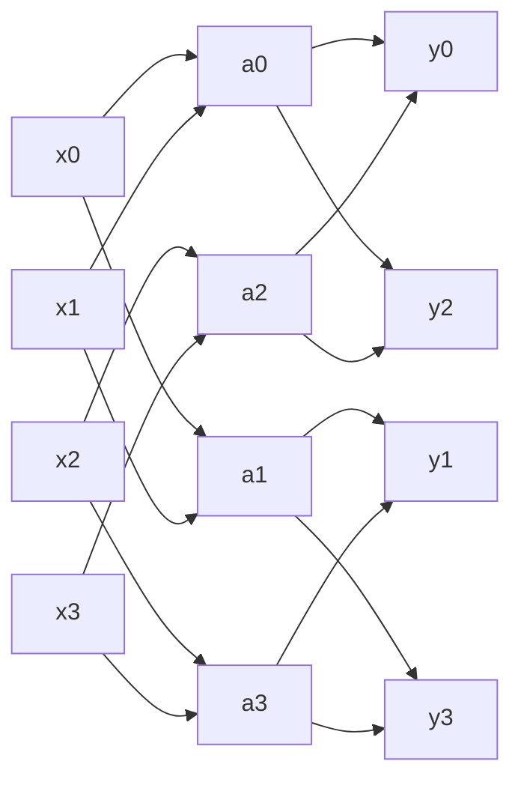

# Specification Document

## Administrative information

- **Study programme**: Bachelor's in Mathematics (Theoretical Computer Science)
- **Project documentation language**: English
- **Implementation language**: C++17
- **Languages I can peer-review**: Python and C++

---

## Problem being solved

### Goal

This project asks whether a **butterfly-structured linear layer** can replace a
**dense linear layer** in a small neural network without a meaningful loss in accuracy,
while using far fewer parameters and arithmetic operations.

Everything is implemented from scratch in C++: tensors, forward and backward passes,
and the optimizer. No machine-learning libraries or automatic differentiation are used.

### Background: why butterfly layers?

**A neural network layer is a matrix multiplication.** A neural network turns an input
(here a 28×28 image flattened into 784 numbers) into an output (here 10 scores, one per
digit) by passing it through layers. The most common layer is the **dense (fully
connected) layer**, which multiplies the input vector by a weight matrix *W* and adds a
bias vector *b*: *y = Wx + b*. Training adjusts *W* and *b* so that the network's answers
improve. The adjustments are computed with **backpropagation**, which applies the chain
rule to find how much each weight contributed to the error.

**Dense layers grow quadratically.** A dense layer from *n* inputs to *n* outputs stores an
*n × n* matrix: *n²* weights and *n²* multiplications per input. Doubling the width makes
the layer four times as expensive, and in large models these matrices dominate memory use
and running time.

**The idea: borrow the structure of the FFT.** Some *n × n* matrices can be applied much
faster than *n²*. The classic example is the Discrete Fourier Transform: direct
multiplication costs *O(n²)*, but the Fast Fourier Transform (FFT) computes the same result
in *O(n log n)* by divide and conquer, the same principle as merge sort. The FFT can be
written as a product of log₂ *n* very sparse matrices, each of which only mixes **pairs**
of positions with a small 2×2 operation. Drawn as a diagram, the connections look like
butterfly wings. For *n* = 4:

In stage *s* (counting from 0), position *i* is paired with position *i* XOR 2^*s*: stage 0
mixes neighbours (0,1), (2,3); stage 1 mixes (0,2), (1,3). After log₂ *n* stages every
output depends on every input, just as in a dense layer.

A **butterfly layer** keeps the FFT's wiring but replaces its fixed 2×2 operations with
**learnable** 2×2 weight blocks, trained by backpropagation like any other weights
(Dao et al., 2019). Each stage has *n*/2 blocks of 4 weights, so the layer has
2*n* log₂ *n* weights (plus *n* biases):

| Width *n* | Dense weights (*n²*) | Butterfly weights (2*n* log₂ *n*) | Ratio |
|-----------|----------------------|-----------------------------------|-------|
| 8         | 64                   | 48                                | 1.3×  |
| 64        | 4,096                | 768                               | 5.3×  |
| 512       | 262,144              | 9,216                             | 28×   |
| 4,096     | 16,777,216           | 98,304                            | 171×  |

**The catch.** A butterfly layer cannot represent every matrix: it has far fewer free
parameters than *n²*, so it can only express matrices with this particular structure.
Whether that restriction hurts on a real learning task is the question this project
tests. The question is practically relevant: structured matrices descended from this idea,
such as Monarch matrices (Dao et al., 2022), are used to make large models cheaper to
train. It also links two parts of this course: a classical algorithm (the FFT) is reused
as the structure of a learnable model.

### Experiment

The task is classifying MNIST handwritten digits. Three networks are trained with
identical hyperparameters (Adam, same learning rate, batch size and epochs) and identical
random seeds. Each network is 784 → 512 → ReLU → *hidden layer* → ReLU → 10, and they
differ only in the hidden 512 → 512 layer. The ReLU after the hidden layer is essential:
without it, the hidden layer and the output layer would collapse into a single linear map,
and all three variants could represent exactly the same functions.

| Variant     | Hidden layer                    | Parameters | Multiply-adds per image |
|-------------|---------------------------------|------------|-------------------------|
| `none`      | skipped (784 → 512 → 10 only)   | 0          | 0                       |
| `dense`     | full 512×512 matrix + bias      | 262,656    | 262,144                 |
| `butterfly` | 9 stages of 2×2 blocks + bias   | 9,728      | 9,216                   |

`none` is a lower bound: it shows whether a hidden mixing layer helps at all. The butterfly
replaces the hidden layer rather than the first layer because the butterfly needs a
power-of-two width, and 784 is not one.

**Measured:** accuracy on the 10,000-image MNIST test set, parameter count of the hidden
layer, and training time per epoch.

**Hypothesis:** the butterfly variant reaches test accuracy close to the dense variant
(within about one percentage point) with roughly 27× fewer parameters in the hidden layer.

---

## Algorithms and data structures

- **Tensor**: a row-major multidimensional array (`std::vector<float>` plus shape and
  strides) with element access, matrix multiplication, transpose and reductions.
- **Dense linear layer**: forward *y = xW + b* and manual backward pass for the input,
  weights and bias.
- **Butterfly linear layer**: log₂ *n* stages of *n*/2 learnable 2×2 blocks with the
  FFT-style pairing above, plus a bias; manual backward pass for the input, every block
  and the bias.
- **ReLU activation** and **softmax with cross-entropy loss** (numerically stable via the
  log-sum-exp trick), with their gradients.
- **Adam optimizer**: per-parameter first and second moment estimates with bias
  correction.
- **MNIST IDX loader**: reads the binary image and label files and scales pixels to [0, 1].

## Inputs and how they are used

- **MNIST data**: the four standard IDX files (`train-*` with 60,000 images, `t10k-*` with
  10,000 images). Each image is flattened to a 784-dimensional vector. Training uses the
  `train` files in shuffled mini-batches; the `t10k` files are used only for the final
  test accuracy.
- **Command-line options**: network variant (`none`, `dense`, `butterfly`), number of
  epochs, batch size, learning rate, random seed, data directory, and an optional CSV log
  file.

Each training step reads a mini-batch, runs the forward pass, computes the cross-entropy
loss, backpropagates gradients through every layer, and updates parameters with Adam.

---

## Expected time and space complexity

Let *B* be the batch size, *n* the hidden width (512), and *d* = 784 the input width.

| Operation (per batch)        | Dense *n → n*      | Butterfly *n → n*         |
|------------------------------|--------------------|---------------------------|
| Forward time                 | Θ(*B n²*)          | Θ(*B n* log *n*)          |
| Backward time                | Θ(*B n²*)          | Θ(*B n* log *n*)          |
| Parameters                   | Θ(*n²*)            | Θ(*n* log *n*)            |
| Stored activations           | Θ(*B n*)           | Θ(*B n* log *n*)          |

The butterfly cost comes from log₂ *n* stages, each applying *n*/2 independent 2×2 blocks
(4 multiply-adds per pair, so Θ(*n*) per stage per input). The backward pass visits the
same pairs in reverse order, so it has the same order. The butterfly stores the input of
every stage for the backward pass, hence the extra log *n* factor in activation memory.

The whole network costs Θ(*B d n*) per batch for the first layer in every variant, so the
first layer dominates the running time. One epoch costs Θ(*N d n*) for *N* = 60,000
training images. The difference between variants is therefore clearest in the hidden
layer's parameter count and operation count, not in the total time.

---

## Core of the project

The core is implementing **from scratch in C++ a small feed-forward network with both
dense and butterfly-structured linear layers, including their full backpropagation**, and
comparing the two on MNIST. The essential parts are the butterfly layer's forward and
backward passes and convincing tests that they are correct. MNIST loading, the command
line and the plotting script are supporting code.

---

## Changes from the original plan

The original week 1 plan is kept as the core. Three changes were made during the course:

- **Fixed 2×2 blocks.** The original plan mentioned block sizes *b* ∈ {2, 4, 16}. The
  implementation uses *b* = 2 with log₂ *n* stages, which is the classic FFT structure and
  already gives the full *O(n log n)* versus *O(n²)* comparison.
- **Adam instead of plain SGD.** Adam converges reliably without tuning a momentum
  schedule, which keeps the comparison between variants fair with one shared set of
  hyperparameters.
- **Transformer removed.** For a while the repository also contained a decoder-only
  transformer built on the same primitives. It was not part of the original plan and has
  been removed from the main branch to keep the project focused on the question above.

---

## Sources

- Tri Dao, Albert Gu, Matthew Eichhorn, Atri Rudra, Christopher Ré: *Learning Fast
  Algorithms for Linear Transforms Using Butterfly Factorizations*. ICML 2019.
- Tri Dao et al.: *Monarch: Expressive Structured Matrices for Efficient and Accurate
  Training*. ICML 2022.
- Cormen, Leiserson, Rivest, Stein: *Introduction to Algorithms*, 3rd ed., chapter 30
  (Polynomials and the FFT).
- Michael Nielsen: *Neural Networks and Deep Learning* (online book), chapters 1–2.
- Goodfellow, Bengio, Courville: *Deep Learning*, chapters 6 and 8.
- Diederik Kingma, Jimmy Ba: *Adam: A Method for Stochastic Optimization*. ICLR 2015.
- Yann LeCun et al.: MNIST database of handwritten digits.
