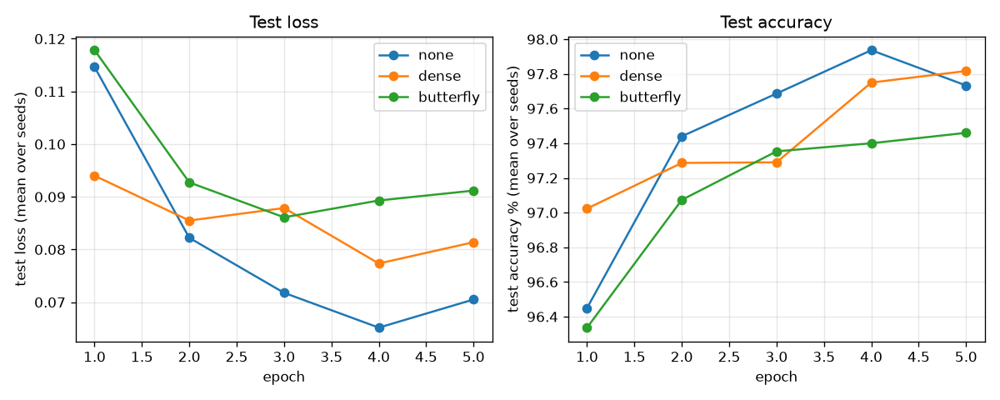
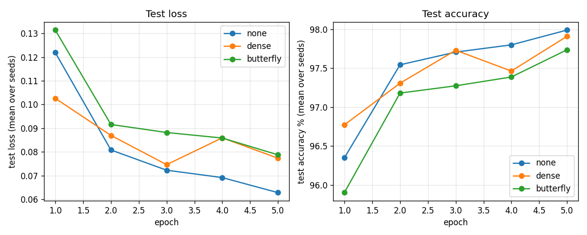

# Testing Document

## 1. Approach

The program has to compute gradients by hand, so the main risk is a backward pass that is
**wrong but has the right shape**: a missing transpose, a swapped index or a gradient summed
over the wrong axis. Training still runs with such a bug, just worse, so the bug is easy to
miss. The tests therefore check correctness against independent references, not just
shapes:

1. **Hand-computed values** on tiny inputs, where the answer can be verified on paper.
2. **Finite-difference gradient checks**: each analytic gradient is compared with the
   central difference (L(p + h) − L(p − h)) / 2h, nudging one parameter element at a time
   ([`tests/grad_check.hpp`](../tests/grad_check.hpp)).
3. **Known transforms**: the butterfly layer must reproduce the Walsh–Hadamard transform
   and agree with an explicitly built dense matrix at the width used in the experiment.
4. **An integration test** of the whole training loop on synthetic data with a known answer.

All tests use [GoogleTest](https://github.com/google/googletest) and fixed random seeds, so
every run is identical. None of them need the MNIST download.

## 2. What is tested and with which inputs

### Butterfly layer ([`test_butterfly_linear.cpp`](../tests/test_butterfly_linear.cpp))

| Test | Input and why it was chosen |
|------|-----------------------------|
| Single block by hand | n = 2: one stage with one 2×2 block, so the layer is exactly y = Wx + b and every output can be checked on paper. |
| Walsh–Hadamard transform | All blocks set to [[1, 1], [1, −1]], at n = 8 and n = 512. The result must be the Hadamard matrix H[i][j] = (−1)^popcount(i AND j). This catches any error in which positions are paired in each stage, or which block a pair uses, at the experiment's width. |
| Full connectivity | Random blocks at n = 64: every entry of the implemented matrix must be non-zero, confirming that after log₂ n stages every output depends on every input. |
| Forward vs explicit matrix | n = 512 with random weights and a batch of 4 rows: the batched forward pass must match an ordinary dense matrix product built from the layer's response to unit vectors. Several rows catch batch-indexing bugs. |
| Gradient checks | Random weights at n = 8 (3 stages, every element checked) and n = 64 (6 stages, larger strides) with a batch of 3: gradients for the input, every stage and the bias. |
| Parameter count | n = 2, 8, 512 against 2n log₂ n + n; these are the counts reported in the results. |
| Invalid input | Widths 0, 1, 3, −4 and 784 (not powers of two), wrong input shapes, backward before forward, and a batch size that differs from the forward pass. |

### Other components

| Component | Tests and inputs |
|-----------|------------------|
| `DenseLinear` ([test](../tests/test_dense_linear.cpp)) | Forward and backward against hand-computed 2×3 examples; gradient check on a random **non-square** 7 → 4 layer with batch 5, where a transposed weight gradient would have the wrong shape and a mis-summed bias gradient the wrong values; invalid sizes. |
| Softmax and cross-entropy ([test](../tests/test_nn_ops.cpp)) | Logits [0, ln 2, ln 3], whose softmax is exactly [1/6, 2/6, 3/6], so the loss (ln 2 + ln 3)/2 is known in closed form. The same logits shifted by ±1000, which overflow without the max-subtraction trick. A gradient check on random logits with 10 classes (MNIST shape). Labels out of range or of the wrong shape. |
| ReLU ([test](../tests/test_nn_ops.cpp)) | Hand values on both sides of 0; gradient check on random inputs moved at least 0.1 away from the kink at 0, where the derivative does not exist. |
| Adam ([test](../tests/test_adam.cpp)) | The first update is exactly lr · g/(\|g\| + ε); a constant gradient moves by lr per step; updating one parameter must not change another's bias correction. The last test exists because an earlier version shared one step counter across all parameters. |
| `Mlp` ([test](../tests/test_mlp.cpp)) | Parameter counts at the experiment size; identical output for identical seeds (the comparison relies on this); an **end-to-end gradient check** of the cross-entropy loss with respect to every parameter of every layer, for all three variants. |
| Training loop (integration, [test](../tests/test_mlp.cpp)) | Four Gaussian clusters in 16 dimensions (200 training points, 100 fresh held-out points). After 150 Adam steps, each variant must cut the loss by 90 % and reach ≥ 98 % training and ≥ 95 % held-out accuracy. |
| `Tensor` ([test](../tests/test_tensor.cpp)) | Strides, copy and move semantics, reshape, bounds and rank checks, and `matmul` against a textbook triple loop on odd 37×53 · 53×29 sizes. |
| MNIST loader ([test](../tests/test_mnist_loader.cpp)) | A two-image IDX file written to a temporary directory: shapes, labels, pixel scaling to [0, 1], train and test file names, bad magic number, missing directory. |

### Do the tests catch real bugs?

To check that the gradient tests are sensitive, a typical backpropagation bug was planted:
in the butterfly backward pass, `w(k, 1, 0)` was replaced by `w(k, 0, 1)`, which forgets to
transpose the block. The forward tests still passed, but both butterfly gradient-check tests
failed. The test suite in the earlier version of the project only checked the stage-weight
gradients, so it would have missed this bug.

## 3. Empirical results

The experiment itself is described in the [implementation document](implementation.md#3-results).
The plots show the test loss and test accuracy after every epoch, averaged over three seeds.
The experiment was run on Linux (GCC) and repeated on macOS (Clang); the two runs differ in
the order of the training data (see the implementation document).

Linux / GCC:



macOS / Clang:



## 4. Coverage

Line coverage of the library sources, summarized with `gcovr`. It was measured with both
compilers; they count slightly different lines as executable, so the totals differ a little:

| File | GCC (Linux): lines | Covered | Clang (macOS): lines | Covered |
|------|-------|---------|-------|---------|
| `src/adam.cpp` | 23 | 100 % | 26 | 100 % |
| `src/mlp.cpp` | 101 | 98 % | 111 | 99 % |
| `src/butterfly_linear.cpp` | 102 | 97 % | 109 | 97 % |
| `src/tensor.cpp` | 194 | 95 % | 215 | 95 % |
| `src/nn_ops.cpp` | 74 | 94 % | 85 | 96 % |
| `src/parameter_init.cpp` | 26 | 92 % | 28 | 92 % |
| `src/dense_linear.cpp` | 47 | 91 % | 50 | 92 % |
| `src/mnist.cpp` | 61 | 85 % | 63 | 85 % |
| `src/activations.cpp` | 14 | 78 % | 16 | 93 % |
| **Total** | **642** | **94 %** | **703** | **95 %** |

All 56 tests pass on both platforms, in both Debug and Release builds.

The uncovered lines are mostly error branches (truncated files, bad image sizes) and simple
accessors. The command-line program `apps/train_mnist.cpp` is not unit-tested: it only parses
options and prints results, and the logic it calls is covered by the `Mlp` tests.

## 5. Reproducing the tests and coverage

```bash
cmake -S . -B build -DCMAKE_BUILD_TYPE=Debug
cmake --build build
./build/tests                      # or: cd build && ctest --output-on-failure
```

Coverage:

```bash
cmake -S . -B build-coverage -DENABLE_COVERAGE=ON -DCMAKE_BUILD_TYPE=Debug
cmake --build build-coverage
./build-coverage/tests
pip install gcovr                  # once
gcovr -r . --filter 'src/' build-coverage                         # table as above
gcovr -r . --filter 'src/' build-coverage --html-details -o coverage.html   # browsable report
```

On macOS, Apple Clang writes LLVM-format coverage data, so `gcovr` must use LLVM's `gcov`:

```bash
gcovr -r . --filter 'src/' --gcov-executable "xcrun llvm-cov gcov" build-coverage
```

## 6. Limitations

- Gradient checks use 32-bit floats, so tolerances are about 1 % relative. This is loose
  enough for rounding error but far tighter than the error a real bug causes.
- There are no tests for performance; running time is measured in the experiment instead.
- The integration test uses easy synthetic data. Whether the network learns *MNIST* well is
  shown by the experiment, not by a unit test, because a full MNIST run takes minutes.
